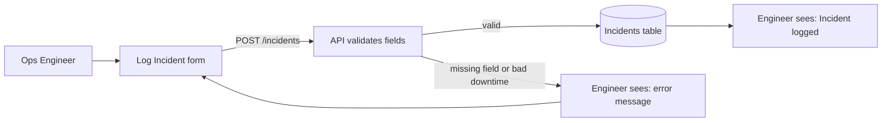
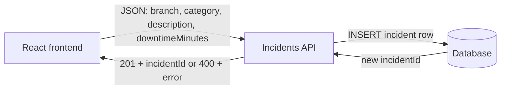

# T7B Design — Card 1: Log an Incident

**Group members and roles:**

- Diagrammer: Olysia Dmytrush
- Contract Writer: Cee-Jay Daniels
- Story Checker: Briana Heredia
- Presenter: ___

## User story

> As an Ops Engineer, I want to log an incident with the branch, category, description and downtime minutes, so that IT sees every disruption in one place.

## Story breakdown

- **Inputs:** branch, category, description, downtime minutes
- **Process:** Ops Engineer fills out the Log Incident form → React sends the data to the API → API checks every field is present and downtime is a whole number 0 or higher → API saves the incident to the database
- **Outputs (success):** `201 Created` with the new incident ID; the engineer sees "Incident logged"
- **Outputs (failure):** `400 Bad Request` if a field is missing, the category isn't on the list, or downtime isn't a whole number (like "forty"); the engineer sees an error and fixes the form
- **Interface:** `POST /incidents`

## Workflow diagram

## Component diagram

## Contract

See `schema.json`.

## Traceability

| Story phrase | Where it shows up in the design |
| :---- | :---- |
| "Ops Engineer" | First box in the workflow diagram |
| "log an incident" | `POST /incidents` endpoint; arrow from frontend to API |
| "branch, category, description" | Three required string fields in `schema.json` |
| "downtime minutes" | `downtimeMinutes`: integer, minimum 0, so "forty" is rejected |
| "IT sees every disruption in one place" | Incidents table in the database; success message |

## What we changed after feedback

- Made `category` a fixed list (Scanner, Conveyor, System) because the other group asked "What happens if someone types a random category?" — free text would make it hard for IT to see patterns.